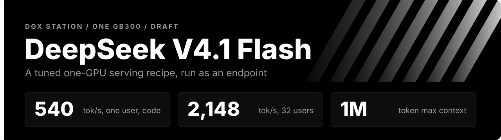
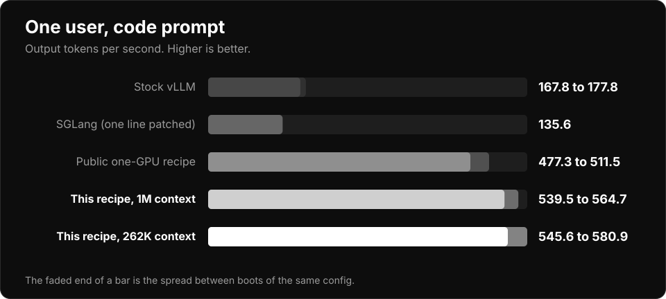
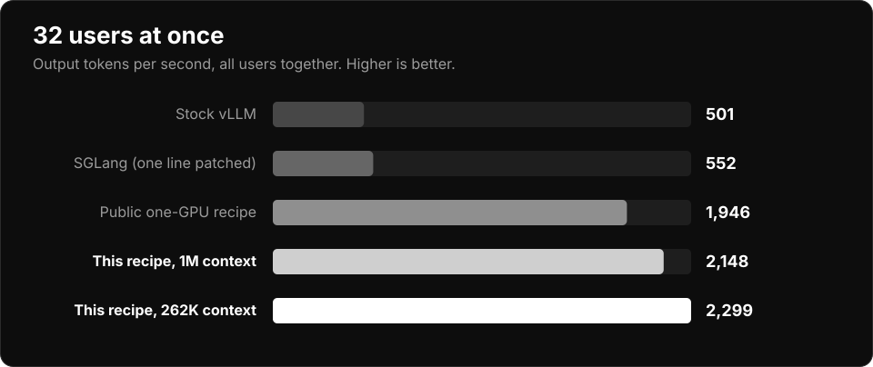
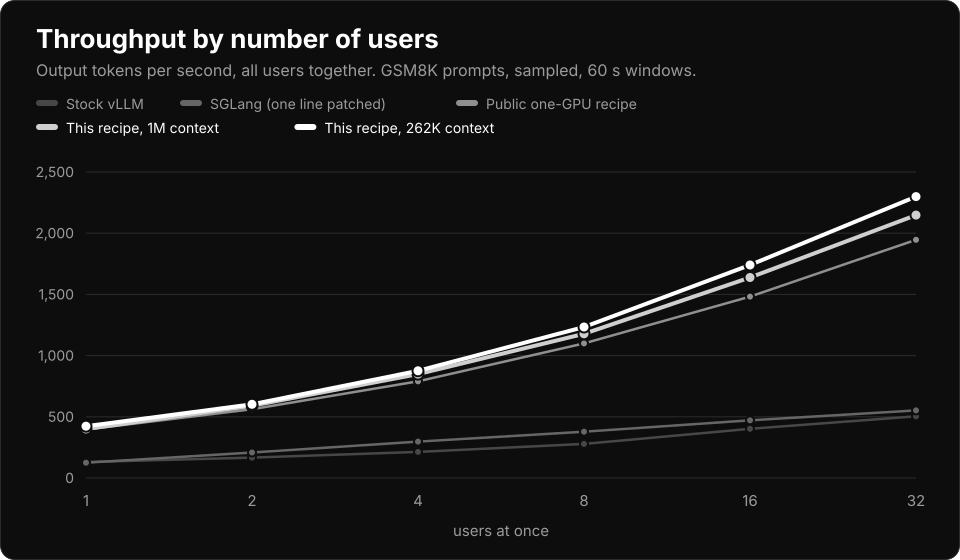
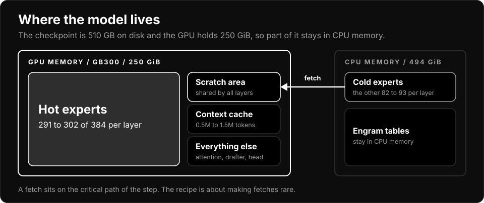

<p align="center">
  
</p>

<p align="center">
  
  
  
  
</p>

A serving recipe for stock DeepSeek-V4.1-Flash-1017 on a DGX Station with one GB300, run headless as an OpenAI-compatible endpoint.

Most of the speed comes from two pieces of open source work: [Garner McCloud's engine](https://github.com/garnermccloud/dgx-station-recipes) and [James Meadlock's one-GPU expert tier](https://al-engr.com/gb300-dsv41-one-gpu-gracetier.html). This repo ports that recipe to a Station without the second GPU card, fits more of the model into GPU memory, and adds one kernel patch.

> [!NOTE]
> Draft. Everything here was measured on one Station on 18 and 19 November 2026, most cells once. Nothing has been reproduced on a second machine. The section [What was checked](#what-was-checked) lists what is still open.

**For engineers comparing offloading strategies:** [`docs/offloading.md`](docs/offloading.md) describes what is kept where, what happens on a cold pick, how the resident set adapts, and exactly what differs from stock vLLM, with source citations.

## The numbers

<p align="center"></p>
<p align="center"></p>

Output tokens per second unless stated.

| | Stock vLLM | SGLang (one line patched) | Public one-GPU recipe | This recipe, 1M | This recipe, 262K |
|---|---:|---:|---:|---:|---:|
| One user, code prompt | 167.8 to 177.8 | 135.6 | 477.3 to 511.5 | **539.5 to 564.7** | **545.6 to 580.9** |
| One user, 40 mixed prompts | 132 to 138 | not run | 289 to 293 | **310 to 330** | **336 to 344** |
| One user, reasoning | 130.8 to 134.5 | 124.8 | 396.1 | **400.6** | **423.3** |
| 8 users | 279 | 378 | 1,100 | **1,178** | **1,234** |
| 32 users | 504 | 552 | 1,946 | **2,148** | **2,299** |
| Prefill, 114K-token prompt | 28,210 | 14,352 | 49,477 | **51,686** | **53,136** |
| Time to first token, code prompt | 234 to 248 ms | 440 to 538 ms | 142 ms | **126 ms** | **119 ms** |
| GSM8K-200 correct | 193 | 195 | 195 | 196 | 195 |

<p align="center"></p>

### How each column was run

All five were measured on the same Station with the same benchmark, `bench_full.py` from Garner McCloud's repo, and James Meadlock's two prompt sets for the mixed-prompt row. They were not run with identical settings, and that matters when reading the ratios.

| | Stock vLLM | SGLang (one line patched) | Public one-GPU recipe | This recipe, 1M | This recipe, 262K |
|---|---|---|---|---|---|
| Engine | vLLM v0.32.0, its own Station config | nightly `6b374a55`, one check removed | vLLM v0.31.0 + McCloud engine + Meadlock tier | the same, plus our patches | the same, plus our patches |
| Experts in GPU memory per layer | set by a byte budget (`--cpu-offload-gb 60`) | 255 | 275 | 291 | 302 |
| GPU memory fraction | 0.97 | 0.90 | 0.95 | 0.98 | 0.98 |
| Max context | 1M | 262K | 1M | 1M | 262K |
| Draft model | on, 3 draft tokens | off (its expert tier rejects it) | on: 5 or 7 draft tokens for one user, 5 for 2 to 4 users, 3 from 5 users up | as the public recipe | as the public recipe |
| Requests running at once | 24, so at 32 users 8 wait | 32 | 32 | 32 | 32 |
| Runs behind the stream rows | mean of two warmed passes | mean of two passes | mean of two warmed passes | one window in a full session | one window in a full session |

- The comparison with the public recipe is like for like: same engine, same benchmark, same settings apart from the ones this repo changes.
- The comparison with stock vLLM and SGLang is not: the settings in the table above differ. Stock vLLM was run in two boots, the second warmed like our own runs. Its many-user speeds were the same both times (274 to 283 at 8 users, 501 to 506 at 32), which is 14% under the numbers published for that config (326 and 584). We do not know why. Against the published 584, this recipe at 1M is 3.7 times at 32 users, not 4.3.
- Stock SGLang does not load this model on one GB300. The SGLang column is a nightly build with one line changed, and it has no draft model.
- Launch commands: `harness/setup/station_stock_baseline.sh` (stock vLLM), `harness/sglang/station_sglang_e2d.sh` with `sglang_e2_entry.sh` (SGLang), `configs/` (this recipe).
- Every number, with its source file, is in [`results/summary.json`](results/summary.json). Raw scoreboards: [`results/raw`](results/raw). Run logs: [`results/logs`](results/logs).

### Reading the one-user numbers

Speed is steps per second times tokens per step. The draft model sets the second factor, and the offload tier only affects the first. On the code prompt:

| | Tokens per second | Tokens per step | Steps per second |
|---|---:|---:|---:|
| Stock vLLM, first boot | 177.8 | 3.60 | 49.5 |
| Stock vLLM, second boot | 167.8 | 3.50 | 47.7 |
| Public one-GPU recipe | 510.5 | 5.42 | 95.0 |
| This recipe, 1M | 564.7 | 5.57 | 101.1 |
| This recipe, 262K, draft count fixed at 3 | 445.3 | 3.55 | 125.8 |
| SGLang (one line patched), no draft | 135.6 | 1.00 | 135.6 |

- Against stock vLLM's faster boot, the 3.2 times on the code prompt is 2.0 times the step rate and 1.5 times the tokens per step. With the draft count held at stock's 3, it is 2.5 times. Against its slower boot the same four figures are 3.4, 2.1, 1.6 and 2.7.
- At 32 users the tokens per step are close (3.07 here, 2.81 on stock), so that gain is almost all step rate.
- **The prompts repeat.** The code prompt is one prompt run six times, with a random first line so nothing is served from cache. The many-user rows rotate through 200 GSM8K questions. The mixed-prompt row uses 40 distinct prompts.
- **The numbers are settled speeds.** The engine moves experts toward the traffic it sees, so repeats of a prompt get faster: the five timed runs on the code prompt at 1M were 489, 565, 522, 565 and 611. Stock vLLM is flat (169 to 179 in its first boot, 165 to 171 in its second). The first timed run is 2.8 times stock's faster boot; the median is 3.2 times.
- **Prompts the server has not seen run slower at first.** In one test on the mixed prompts, a prompt set the server had not seen ran at 317 tok/s on first contact against 333 to 335 once settled (5% under). On a freshly booted server the first set ran at 284 against 334 to 340 settled (15% under). That is 2.1 to 2.4 times stock vLLM on first contact, against 2.4 to 2.5 times settled.
- **Short bursts are slower.** 64 short requests sent at once, 32 at a time, ran at 1,050 to 1,135 tok/s on the 262K profile, against 2,299 in the steady 60-second window.

### Where this does not lead

A Station with an RTX PRO 6000 added can run Garner McCloud's two-GPU recipe, and that is faster at decode: 733.6 tok/s for one user and 2,524 at 32 users (his published numbers, not measured by us). The second card removes the CPU-memory fetches that set the pace here. This recipe is for the Station with only the GB300.

## Whose work is in the gain

| Step | Whose work | One user, code prompt | 32 users |
|---|---|---:|---:|
| Stock vLLM | vLLM | 167.8 to 177.8 | 504 |
| Custom engine and one-GPU expert tier | Garner McCloud, James Meadlock | 477.3 to 511.5 | 1,946 |
| More experts in GPU memory and the skip patch, 1M context | this repo | 539.5 to 564.7 | 2,148 |
| A shorter context to fit more experts, 262K | this repo | 545.6 to 580.9 | 2,299 |

With both taken as the first stage of a full benchmark session, the 1M profile is 10.6% over the public recipe on the code prompt (564.7 against 510.5). At 32 users it is 10.4% (2,148 in a full session against 1,946, the mean of two warmed passes); pass for pass it is 10.8%.

## Profiles

| Profile | File | Experts on the GPU per layer (of 384) | Max context | Context cache | One user, code | 32 users |
|---|---|---:|---:|---:|---:|---:|
| Default | [`configs/1m.env`](configs/1m.env) | 291 | 1M | 1.49M tokens | 539.5 to 564.7 | 2,148 |
| 524K | [`configs/524k.env`](configs/524k.env) | 298 | 524K | 0.93M tokens | 545.2 to 566.8 | 2,237 |
| Speed | [`configs/262k.env`](configs/262k.env) | 302 | 262K | 0.52M tokens | 545.6 to 580.9 | 2,299 |
| Public recipe, for reference | upstream | 275 | 1M | 2.71M tokens | 477.3 to 511.5 | 1,946 |

The choice is context against speed. In single sessions each step down in context added 2 to 4% at many users; the step from 524K to 262K is close to the spread between boots. Each step also holds fewer long conversations at once.

Narrower variants, described in [`configs/README.md`](configs/README.md): prefill first, one-user chat, and two experimental capacity profiles that trade 2 to 5% of many-user speed for a context cache of 2.1M to 2.8M tokens.

## How it works

<p align="center"></p>

- **More experts on the GPU.** The public recipe keeps 275 of each layer's 384 experts in GPU memory at 95% utilization. This recipe runs at 98% and keeps 291 at a 1M context, or 302 at 262K. This is the largest gain and it helps at every user count.
- **A skip patch.** A cold expert is copied into a scratch area on the GPU before its layer runs. When a later step needs the same expert and it is still there, the copy is skipped. About a quarter of copies are skipped for one user. With the patch switched on against off on the default profile, one user gained 4.5 to 6.0% on mixed prompts; 8 and 32 users gained 1% or less.
- **Same output as the public recipe.** Neither change alters what the engine produces. See below for what that does and does not cover.

More detail: [`docs/how-it-works.md`](docs/how-it-works.md) and [`docs/offloading.md`](docs/offloading.md). Everything that was tried, including what did not help: [`docs/what-we-tried.md`](docs/what-we-tried.md).

## What was checked

| Check | Result | Evidence |
|---|---|---|
| Same output as the public recipe | 40 prompts, greedy, one user: 9,202 of 9,202 tokens identical, on every profile | `grep "vs reference" results/logs/*.log` |
| Skip patch, byte audit | 217,623 skipped copies compared byte for byte in one-user traffic, 0 differing words. At 16 users, 1,118 sampled skips, 0 differing | `results/logs/gtq7-run.log`, `gtq12-run.log` |
| Accuracy, same session as the speed runs | GSM8K-200: 195 to 196 of 200. Three of three needles in a 174K-token prompt. Tool call passes | `results/raw/*/*.md` |
| The same accuracy checks on stock vLLM | GSM8K-200: 193 of 200. Three of three needles, tool call passes, all 17 long contexts held at once | `results/raw/stock-vllm/stock-score.md` |
| Long contexts held at once (16 prompts of 95K tokens plus one more request) | Default profile: 15 at once, none preempted, all correct. Public recipe: all 17 | `results/raw/this-recipe-1m/score1m-score.md` |
| Mixed load | 10 minutes at 16 users with long prompts arriving, on the speed profile: no errors, no restarts | `results/logs/gtq12-run.log` |
| Long soak | 3.5 hours on the default profile at 2 to 32 users with long prompts arriving throughout: no errors, no restarts, no drift in speed (32 users per round: 1,936, 1,959, 1,948, 1,958). 14,526 sampled skips compared, 0 differing. Accuracy and output identity passed afterwards on the same boot | `results/logs/gtq21-run.log` |
| Skip patch in the tree and switched off | Same output, 40 of 40 | `results/logs/gtq22-run.log`, cell `sk0_1m` |

Not checked, or open:

- **Output against stock vLLM.** The engine does not reproduce stock vLLM token for token: on the 40 prompts, 3 answers have the same text. Stock vLLM does not reproduce itself between boots either. Two boots of stock agreed on the same 3 of 40 answers, although inside one boot it repeats itself on 40 of 40. In both comparisons the other 37 split at a median of token 27, mostly where the top two candidates were close (within 0.5 log-probability in 28 of 37 between stock's two boots, and in 22 of 37 between the engine and stock). So this test cannot tell the engine apart from stock's own variation between boots. The engine matched its own reference capture, taken in another boot, in every boot whose config was not meant to change the output. Two stock boots is a small sample, and the cause was not investigated. The mismatch with stock comes with the public engine, which states that it is not bit-identical to stock; it is the same before and after our changes. Comparisons: [`results/identity/stock-vs-engine.txt`](results/identity/stock-vs-engine.txt), [`results/identity/stock-vs-stock.txt`](results/identity/stock-vs-stock.txt).
- **Small accuracy differences.** GSM8K-200 is near its ceiling (193 of 200 on stock vLLM, 195 to 196 here), so it would not show small damage.
- **Many users.** With several requests in a batch the unmodified engine does not match its own one-at-a-time output (5 of 40 at 8 at a time), so many-user configs are judged by the accuracy checks, not by token identity.
- **Prompts the server has not seen.** One test, on the mixed prompts only. See "Reading the one-user numbers".
- **Context length.** The longest prompt tested is 174K tokens. The 1M limit is configured, not exercised.
- **Long runs.** The longest run is the 3.5-hour soak. Nothing has run for days.
- **The skip patch's audit.** It has no control that must fail, as the packed-scale patch has.
- **A second machine.**

Method and rules: [`docs/method.md`](docs/method.md).

## Running it

There is no one-command setup yet. The scripts in [`harness`](harness) are the record of how our box was built and measured. They expect files at fixed paths on the box (`/raid/work/run`, `/raid/work/gt`, `/raid/models`), which this repo lays out differently; [`harness/README.md`](harness/README.md) gives the mapping. Nobody has run them from a fresh clone. A setup script that builds everything under one directory from this repo is written and not yet tested on the machine.

| Requirement | Value |
|---|---|
| Machine | DGX Station with one GB300, used as a dedicated headless endpoint (nothing else on the GPU) |
| OS and driver | DGX OS 7.6.0, NVIDIA driver 610.43.02, Docker with GPU access. Two fixes our machine needed are in [`PINS.md`](PINS.md) |
| Disk | 510 GB for the checkpoint, plus the build and caches |
| Second GPU card | not needed |
| Versions | every upstream commit and container digest is in [`PINS.md`](PINS.md) |

The steps as they were done:

1. `harness/setup/station_prep.sh` creates the directories, starts the checkpoint download and clones the upstream repos at pinned commits.
2. `harness/setup/station_pg61_build.sh` builds Garner McCloud's engine tree with James Meadlock's patches. CPU only, about two minutes.
3. The container device spec is created once with the `nvidia-ctk` command in `PINS.md`.
4. `harness/setup/station_gt_prep.sh` adds the layout shim for the missing second card and patches a private copy of the upstream launch card with `harness/setup/card-gt1-station.diff`.
5. `harness/setup/station_gt_boot.sh` builds the one-GPU engine, boots it at the published settings and leaves it serving on port 30006.
6. The patches in [`patches/k1-knobs`](patches/k1-knobs) and [`patches/k6-stage-skip`](patches/k6-stage-skip) are applied, the expert map is built with `harness/cells/mkhot.sh`, the setting lines of a profile from [`configs`](configs) are appended to `policy.env`, and the server is restarted.

The endpoint is an OpenAI-compatible API on port 30006, model name `dsv41-flash-gracetier`. In our runs it had no API key and no restart policy.

## Repo layout

| Path | What is in it |
|---|---|
| [`docs/`](docs) | The offloading overview, how it works, the measurement method, and the full list of what was tried |
| [`results/`](results) | `summary.json` with every number in this README, raw scoreboards, run logs, step profiles and the output-identity captures |
| [`configs/`](configs) | One file per profile |
| [`patches/`](patches) | Our patches against the built engine tree: launch knobs, the stage skip, and the experimental packed scale banks |
| [`harness/`](harness) | The scripts that set up the box, ran each measurement and checked output identity |
| [`PINS.md`](PINS.md) | Upstream commits, container digests, model revision, machine |
| [`assets/`](assets), [`tools/`](tools) | The banner and charts, and the script that draws them |

## Changing the look

Colors, fonts and the banner text live in [`assets/theme.json`](assets/theme.json). The charts read their numbers from `results/summary.json`.

```bash
python3 tools/make_assets.py
```

That redraws the banner and every chart, and writes `assets/preview.html` to judge the result locally.

## Credits

- **Garner McCloud** for the engine and the benchmark: [dgx-station-recipes](https://github.com/garnermccloud/dgx-station-recipes).
- **James Meadlock** for the one-GPU expert tier this recipe runs on: [gracetier](https://al-engr.com/gb300-dsv41-one-gpu-gracetier.html).
- **Tomas Cupr** for the stock vLLM Station baseline: [dgx-station-recipes](https://github.com/tomascupr/dgx-station-recipes).
- The vLLM, SGLang and DeepSeek teams.

The tuning was run by an AI agent working on the box overnight, with methods carried over from an earlier recipe for four DGX Sparks: [pico-dgx-ds4](https://github.com/Picom-code/pico-dgx-ds4).

## License

MIT for what is original here: see [`LICENSE`](LICENSE). The patches are diffs against upstream code and carry lines of it, so they stay under the upstream licenses, copied in [`licenses/`](licenses): MIT for Garner McCloud's engine and the J&M Recipes launch files, Apache-2.0 for James Meadlock's gracetier.
